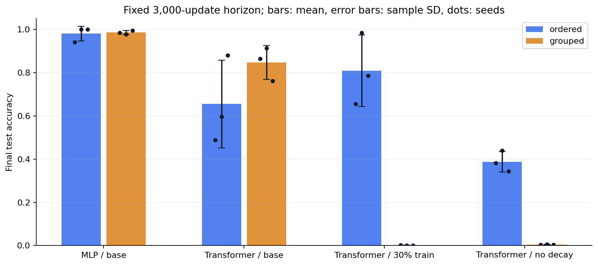
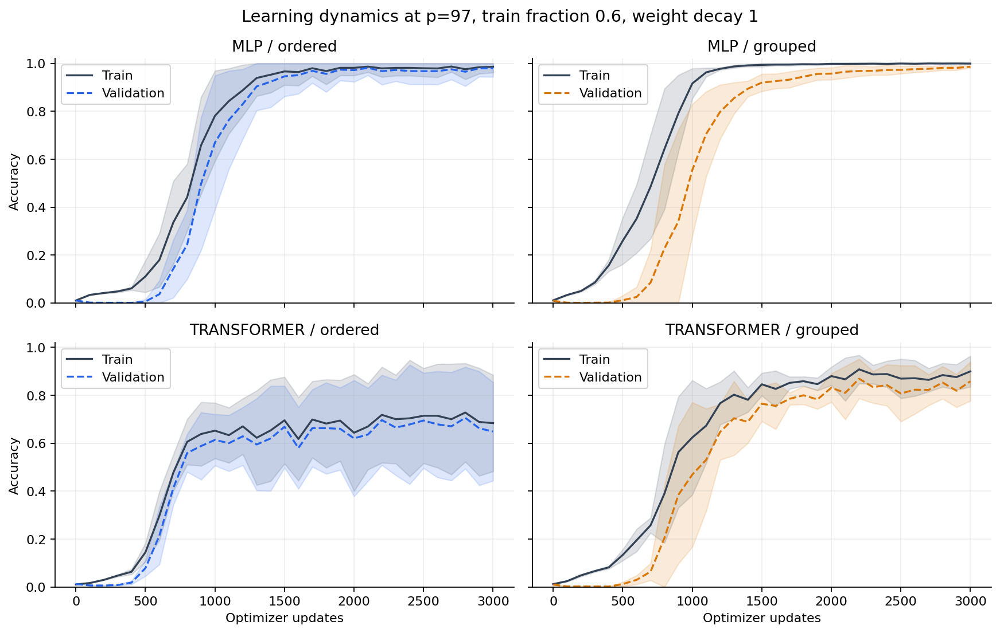
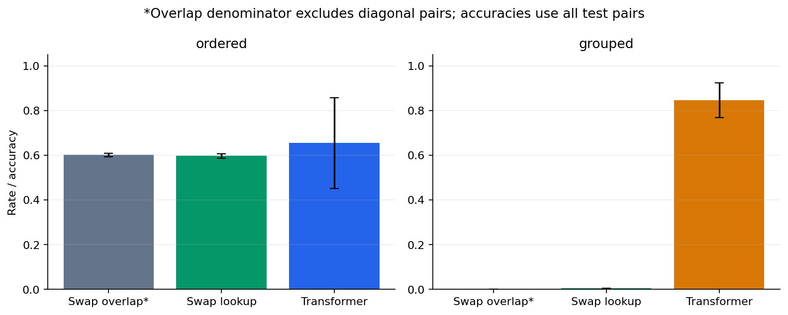
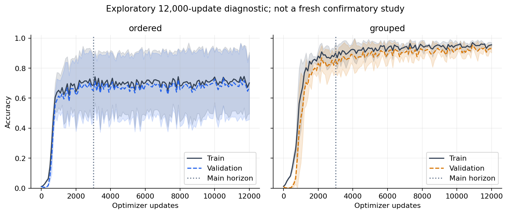

# Beyond Memorization

Beyond Memorization

A controlled study of symmetry-aware evaluation and generalization in small neural networks

Modular addition • Symmetry-aware evaluation • Experiment report

## Abstract

We study modular addition over 97 classes using exact-count ordered-pair and swap-orbit-grouped partitions. An embedding MLP and a one-block causal Transformer are evaluated over three seeds. A fixed matrix contains 24 runs at 3,000 optimizer updates; six explicitly exploratory Transformer runs extend the horizon to 12,000. At the base setting, MLP test accuracy is 98.05 ± 3.37% on ordered partitions and 98.57 ± 0.93% on grouped partitions (mean ± sample SD). A training-label lookup using operand reversal obtains 59.75% on ordered test partitions and 0.50% on grouped partitions without implementing arithmetic. Transformer results depend strongly on the joint training regime and evaluation protocol. No run meets our coarse delayed-generalization criterion. Configurations, learning curves, final checkpoints and per-example test predictions are retained for reproducibility.

## 1  Introduction

A model may predict unseen ordered inputs successfully even when those inputs belong to mathematical equivalence classes already present in training. For addition, (a,b) and (b,a) share a target. Holding out an ordered pair therefore differs from holding out its whole swap orbit. This project asks how that evaluation choice interacts with architecture, data fraction and regularization. Exact input duplicates are excluded in both protocols. Cross-partition reversal is not called an implementation leak: it is a property of the ordinary ordered-input task.

## 2  Related work and scope

Power et al. [1] studied delayed generalization on small algorithmic datasets. Nanda et al. [2] analyzed modular-addition Transformers and used Fourier-space interventions to study learned mechanisms. Gromov [3] examined a simpler neural-network setting for modular arithmetic. These works motivate a tractable task; our models and optimizer schedule are not exact reproductions. We investigate evaluation and finite-budget behavior rather than reverse-engineering a circuit. The comparison focuses on orbit-based evaluation and learning dynamics.

---

## 3  Method

Dataset. For all a,b in {0,...,96}, the target is y=(a+b) mod 97. Inputs contain only integer tokens. There are 9,409 ordered pairs and 97 target classes. The arithmetic formula generates labels; it is never supplied to the learned predictor. No external dataset, download or annotation is required.

| Training fraction | Train | Validation | Test |

| --- | --- | --- | --- |

| 0.60 (base) | 5645 | 1881 | 1883 |

| 0.30 (ablation) | 2822 | 1881 | 4706 |

Partitions. Ordered splits use a seeded permutation of all pairs. Grouped splits allocate unordered two-element swap orbits and singleton diagonal orbits. A parity-constrained allocation gives exactly the same train/validation/test counts as the ordered scheme; diagonal counts are chosen near proportional allocation. Every pair appears once, and no swap orbit crosses a grouped boundary. Class histograms, diagonal counts and byte hashes are retained for auditing. The algorithms do not force the label histograms or orbit coverage to match.

| Model | Architecture | Parameters |

| --- | --- | --- |

| MLP | Shared 32-d token embedding; concatenation; two 128-unit GELU hidden layers | 40,449 |

| Transformer | [a,b,=] tokens; learned positions; one causal pre-norm block, 4 heads, width 32; 128-unit GELU feedforward | 19,201 |

## 3.1  Optimization and controlled matrix

All runs use AdamW, learning rate 0.003, betas (0.9,0.98), no dropout or schedule, and 256 training pairs drawn with replacement per update. Weight decay applies to all parameters. Base weight decay is 1.0. Each architecture runs both splits at training fraction 0.6; Transformer alone also runs fraction 0.3 and decay 0, one factor at a time. Each setting uses seeds 0,1,2. The same seed fixes initialization, partition generation and a separate batch-sampling generator. All recorded runs used one PyTorch CPU thread per worker.

## 3.2  Evaluation and dynamics

Training and validation are measured every 100 updates, including update 0. The final fixed-step checkpoint is evaluated on test; validation does not select a checkpoint. No test curve is used for optimization. Error strata and swap consistency are post-training diagnostics. We flag a delayed-generalization proxy only when first logged train accuracy ≥99% precedes first validation accuracy ≥90% by at least 500 updates. This is a coarse criterion, not proof of an abrupt transition. Missing crossings are censored at the run horizon.

---

## 4  Fixed-horizon results: 3,000 updates

| Model / condition | Ordered test (%) | Grouped test (%) |

| --- | --- | --- |

| MLP / 60%, decay 1 | 98.05 ± 3.37 | 98.57 ± 0.93 |

| Transformer / 60%, decay 1 | 65.46 ± 20.28 | 84.65 ± 7.79 |

| Transformer / 30%, decay 1 | 80.85 ± 16.49 | 0.16 ± 0.10 |

| Transformer / 60%, decay 0 | 38.79 ± 4.79 | 0.46 ± 0.11 |

All values use all three seeds. ± denotes sample standard deviation in percentage points, not a confidence interval. Every final checkpoint is evaluated; no best-seed selection is used.

Figure 1. Final test accuracy across the fixed matrix. Dots show individual seeds; error bars show sample SD.

## 4.1  What the comparison supports

The MLP performs well under both protocols. Its paired grouped-minus-ordered mean difference is +0.51 percentage points with SD 3.45; individual signs differ. The base Transformer has a larger positive mean difference (+19.19 points) but SD 27.13 and mixed signs. These three-seed comparisons do not support a universal ranking of partition difficulty.

The grouped Transformer falls to 0.16% mean test accuracy at 30% training data and 0.46% with no weight decay, while the respective ordered means are 80.85% and 38.79%. These consistently negative paired gaps show strong sensitivity in this specific fixed-budget setup. They do not isolate a universal causal effect of weight decay or exchange symmetry. Low grouped accuracy can coexist with partial fitting of training data; it is not evidence of complete memorization followed by failed grokking.

---

## 4.2  Learning dynamics and retrieval control

Figure 2. Mean train and validation accuracy for base runs; shading is sample SD. Curves are read directly from logged measurements. MLP generalization improves alongside fitting; base Transformer training remains incomplete at the fixed endpoint.

Figure 3. Swap overlap, a non-neural swap lookup and the base Transformer. Overlap excludes diagonal pairs; accuracies include every test pair, so these denominators are intentionally different.

The ordered base test set has 60.17% non-diagonal reversal overlap on average. The lookup memorizes training labels, returns the reversed pair's stored label when available, and otherwise guesses the most common training class. Its 59.75% ordered accuracy falls to 0.50% under grouping. This is a constructive example of protocol sensitivity; it does not establish that either neural network uses this lookup mechanism. Uniform-random chance is 1/97 ≈ 1.03%, but deterministic learned predictions need not attain that benchmark.

---

## 5  Exploratory horizon extension

Because training accuracy showed incomplete base Transformer fitting, all six base Transformer settings were re-run to 12,000 updates with unchanged hyperparameters. This amendment occurred after some original test results had been seen. It is explicitly exploratory, reuses the same partitions and provides no independent confirmatory test. Re-running from the same seeds reproduces the first 3,000 logged updates exactly in all six runs.

| Horizon / base Transformer | Ordered test (%) | Grouped test (%) |

| --- | --- | --- |

| 3,000 (fixed matrix) | 65.46 ± 20.28 | 84.65 ± 7.79 |

| 12,000 (exploratory) | 67.76 ± 20.00 | 93.27 ± 2.35 |

Figure 4. Longer-horizon train/validation means and sample SD; the dotted line marks the original endpoint. The endpoints improve unevenly across partitions. Some trajectories fluctuate substantially.

## 5.1  Grokking outcome

Across 30 runs, 7 reached the logged 99% training threshold and 13 reached 90% validation accuracy. None satisfied the predeclared ≥500-update delay criterion. This means the selected diagnostic was not observed here; it does not contradict published grokking results, prove absence at longer horizons, or validate an alternative mechanism. Finite-budget model comparisons and a negative dynamics result are the substantive outcomes of this study.

## 5.2  Error analysis

Every run retains each test input, target, prediction and whether its reversed pair appeared in training. Separate accuracies are computed for reversal-seen and reversal-unseen test examples; empty strata have an explicit null accuracy. Prediction swap consistency is also stored. Test-only error maps use a predetermined seed 0 for both base Transformer partitions and appear in figures/test_error_maps.png. Gray pixels mean the pair was not evaluated in test. The maps are descriptive and are not a causal probe of network representations.

---

## 6  Discussion

Evaluation defines what generalization means. New ordered pairs and new swap orbits ask different questions, and the retrieval control demonstrates why their scores can differ. Yet grouping does not always lower neural accuracy: model optimization and data coverage interact with partition composition. The near-ceiling MLP results support successful held-out prediction in both schemes, without identifying its internal algorithm. The Transformer ablations reveal a regime worth probing with better-matched controls and longer, stable optimization.

## 7  Limitations and next experiments

Only one modulus, two small architectures and three seeds per setting were tested. Seeds jointly vary initialization and partition membership; there is no crossed seed design separating those sources of variance. Parameter counts differ, and matching update counts does not match architecture-specific compute. Orbit grouping changes the number of distinct mathematical equivalence classes represented in training, plus class and diagonal composition. No Fourier interventions, causal ablations, label-balanced splits or commutative-by-design model were run. The extension is post-hoc and cannot be presented as fresh confirmatory evidence.

A useful follow-up would first freeze new seeds and horizons, add crossed model/partition seeds, separate diagonal pairs, and control label and orbit coverage. Train a permutation-invariant baseline alongside an ordered model to test architectural symmetry. Fourier spectra and interventions could then be used to investigate the mechanisms behind reproducible delayed generalization.

## 8  Reproducibility

The package contains all 30 configurations, raw histories, split arrays/hashes, environment records, final weights, test predictions, per-run and aggregate tables, tests, plot/report builders and a verification command. The artifact verifier reloaded every checkpoint and matched its predictions to saved test arrays. 9.64 minutes is the sum of recorded per-run wall times; workers ran concurrently, so it is not total elapsed time. The CPU environment used Python 3.12.14, PyTorch 2.14.1+cpu and NumPy 2.3.5 (authoritative per-run versions are in environment.json). The Colab helper is supplied but was not executed in Colab.

## References

[1] A. Power, Y. Burda, H. Edwards, I. Babuschkin and V. Misra. Grokking: Generalization Beyond Overfitting on Small Algorithmic Datasets. arXiv:2201.02177, 2022. https://arxiv.org/abs/2201.02177

[2] N. Nanda, L. Chan, T. Lieberum, J. Smith and J. Steinhardt. Progress measures for grokking via mechanistic interpretability. ICLR 2023; arXiv:2301.05217. https://arxiv.org/abs/2301.05217

[3] A. Gromov. Grokking modular arithmetic. arXiv:2301.02679, 2023. https://arxiv.org/abs/2301.02679
